<h1 align="center">Lumen Quill</h1>

<p align="center">
  <strong>A private journal of dated notes, in two moods: Sonata and Palace.</strong><br>
  Same day, keep writing · a new day, continue or begin anew · earlier days locked · light Markdown export and import
</p>

<p align="center">
  
  
  
  
  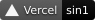
  
  
</p>

<p align="center">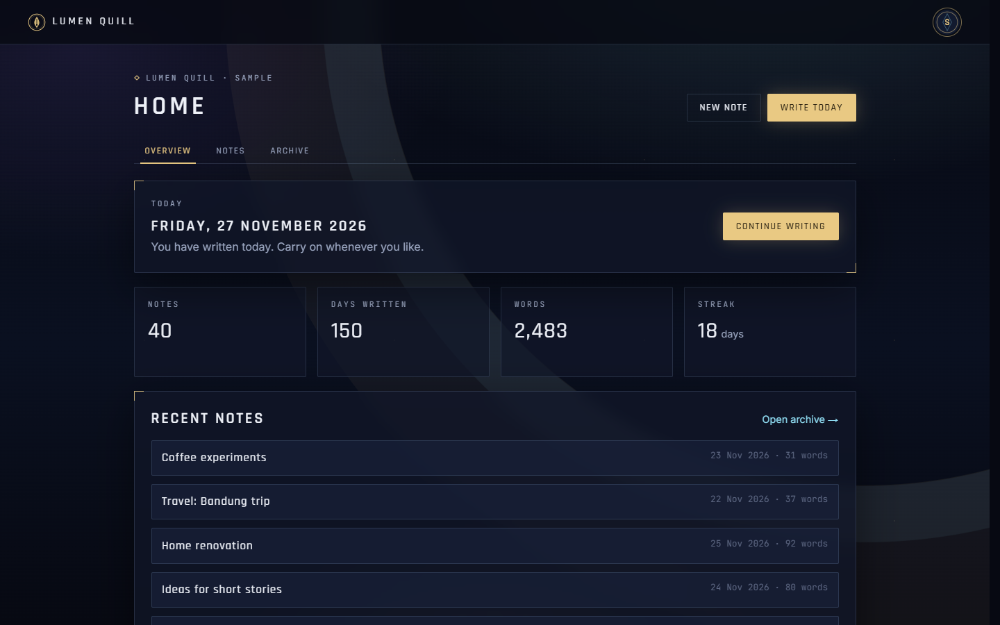</p>

> Every screenshot uses **sample data** (a temporary demo account with generated notes). [Changelog](CHANGELOG.md)

---

## Contents

1. [At a glance](#at-a-glance)
2. [Screenshots](#screenshots)
3. [Features](#features)
4. [Architecture](#architecture)
5. [Getting started](#getting-started)
6. [Commands](#commands)
7. [Documentation](#documentation)
8. [Security](#security)
9. [Conventions](#conventions)
10. [License](#license)

---

## At a glance

Lumen Quill keeps your writing by the day you wrote it. One note is a stack of dated sections. Coming back on the same day simply carries on. On a new day you choose to continue the latest note (a new section below the earlier, now locked, days) or to begin a new note.

| | |
|---|---|
| **Users** | Invitation only. There is no sign-up; the single administrator creates every account |
| **Sign-in** | Google, or e-mail + password (password changes only through an e-mailed link) |
| **Modes** | **Sonata** (modern, celestial) and **Palace** (classic, European court) |
| **Language** | English interface, English documentation and code |
| **Devices** | Desktop, tablet and phone browsers |

| Role | Service | Plan |
|---|---|---|
| Hosting and API | Vercel, region Singapore `sin1` | Hobby |
| Sign-in | Firebase Authentication | Spark (free) |
| Data | Cloud Firestore, `asia-southeast1` (Singapore) | Spark (free) |
| Code, CI, releases | GitHub + GitHub Actions | Free |

## Screenshots

| | |
|---|---|
| 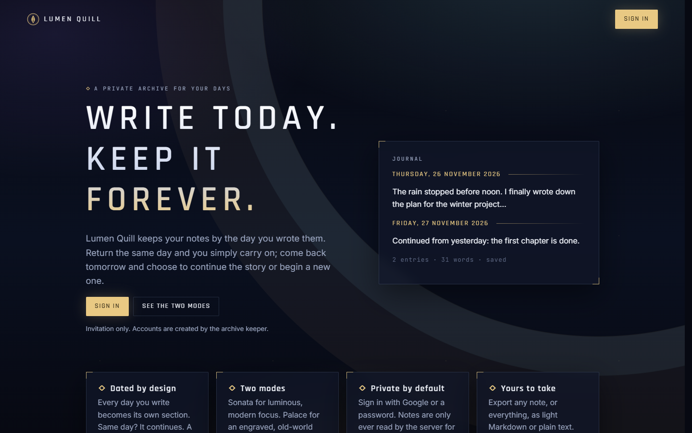<br>**Landing page**, Sonata | 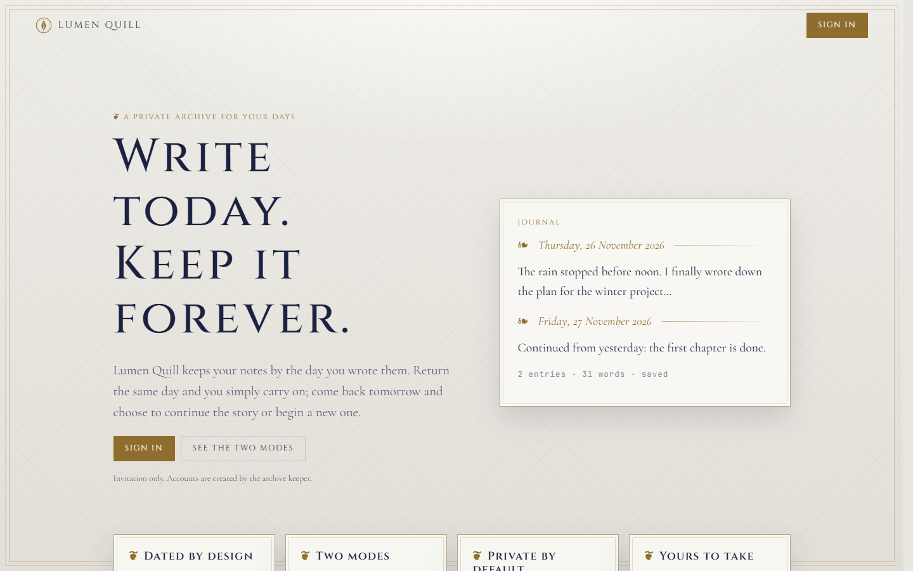<br>**Landing page**, Palace |
| 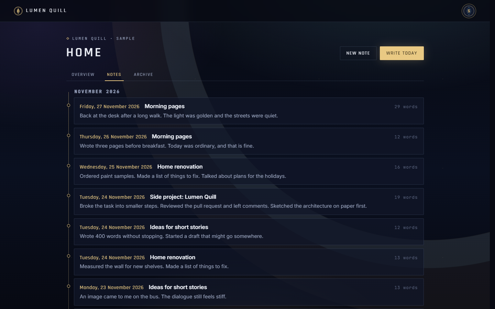<br>**Home → Notes**: every dated entry, newest first | 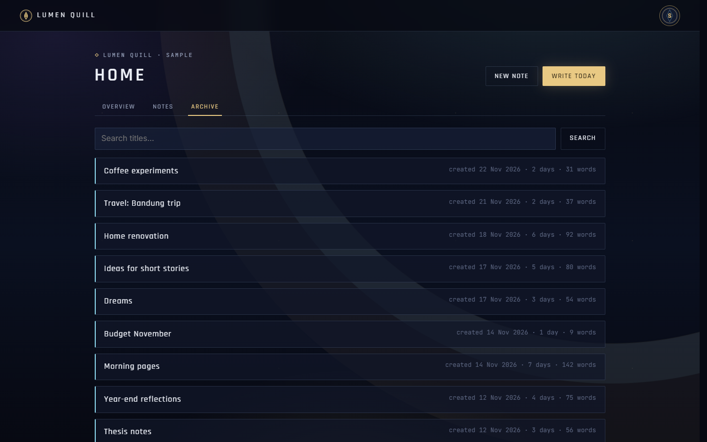<br>**Home → Archive**: notes in creation order, numbered pages |
| 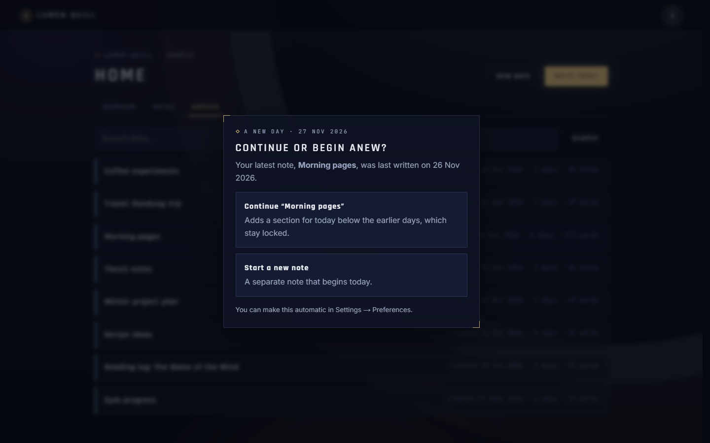<br>**Write today** on a new day: continue or begin anew | 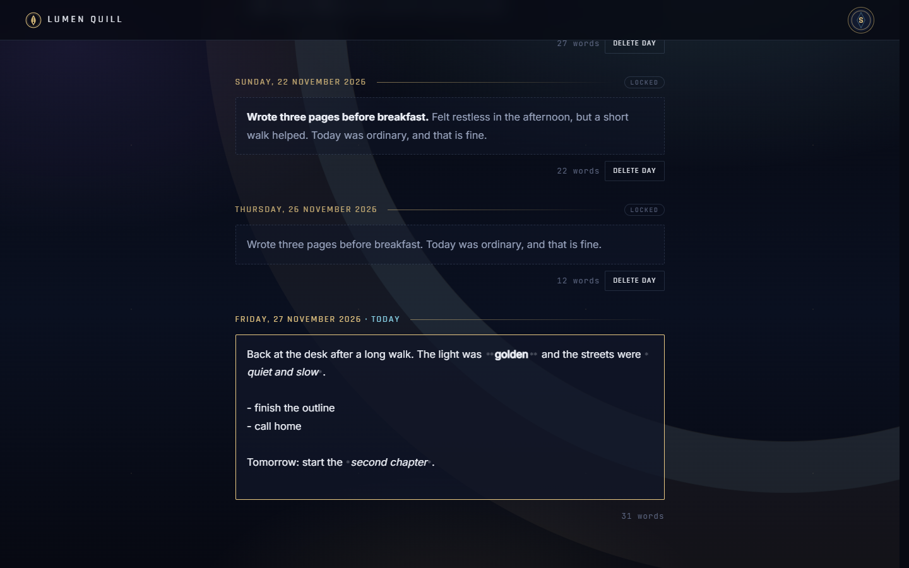<br>**A note**: locked earlier days, today's box with live **bold** / *italic* |
| 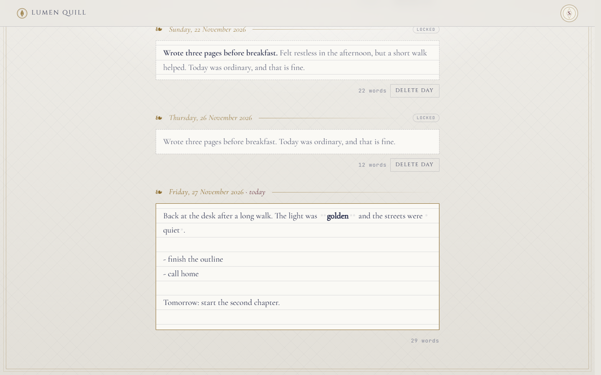<br>**Palace** mode on a ruled page | <p align="center">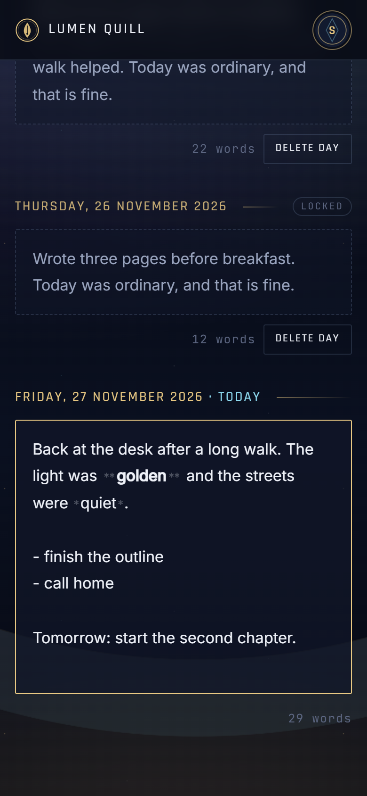<br><strong>Phone</strong></p> |
| 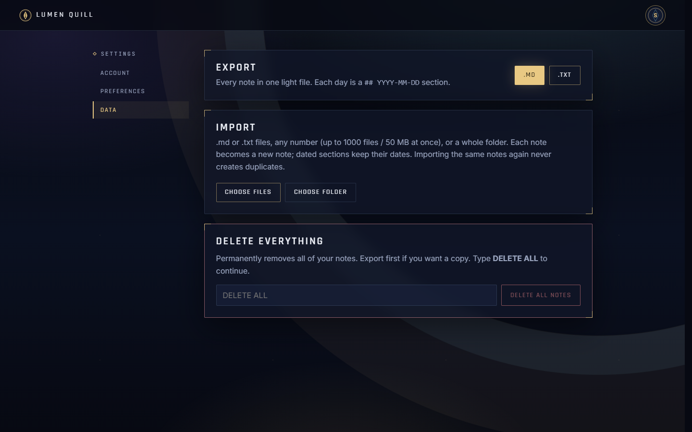<br>**Settings → Data**: export, large imports, delete all | 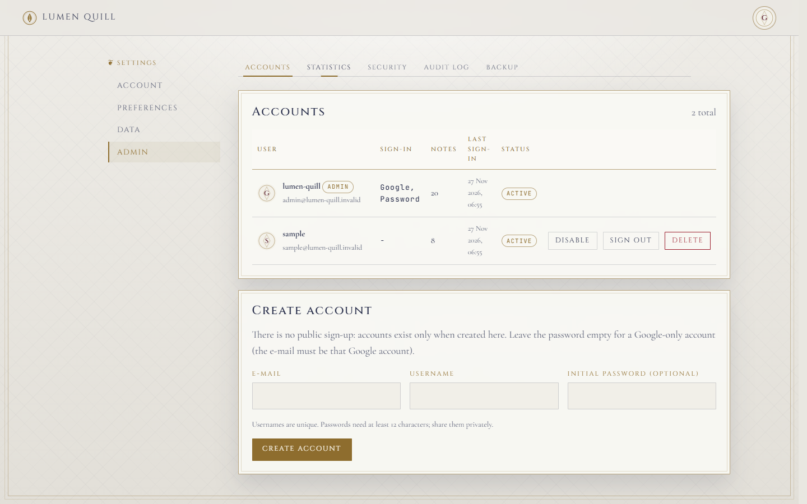<br>**Admin → Statistics** with auto-delete |

The full illustrated guide is in [docs/User-Guide.md](docs/User-Guide.md).

## Features

**Writing**
- Dated sections in the writer's own time zone. The same day continues; a new day asks to continue or start a new note (or does either automatically, as set under Preferences).
- Only **today** can be written; earlier days are locked by the server (read-only, sized to their text, deletable).
- Autosave with a visible status (*Saving…* → *All changes saved*), offline retry with a bounded back-off, protection against two tabs overwriting each other, and the browser's own "Leave site?" warning while a save is pending.
- Light Markdown: `**bold**` and `*italic*` show live while typing (markers small and faint). Locked days are rendered with the markers hidden.
- Empty notes disappear when you leave them.

**Home**
- **Overview**: today, totals, writing streak, recent notes.
- **Notes**: every dated entry across all notes, grouped by month.
- **Archive**: notes in creation order, 20 per page, jump to any page, title search.

**Data**
- Export everything or one note as `.md` or `.txt` (same readable structure, dated file names).
- Import any number of files or a whole folder (up to 1,000 files / 50 MB at once), previewed, sent in chunks with a progress bar, never duplicating a note imported before.

**Account and admin**
- Profile photo (or a themed emblem), unique username, password reset link or "create a password" for Google-only accounts, sign out everywhere.
- Admin: accounts (create, disable, sign out, delete, with confirmations), statistics, security posture, audit log, automatic deletion of statistics and audit data after 1/3/7/30 days, full or date-ranged JSON backup.

## Architecture

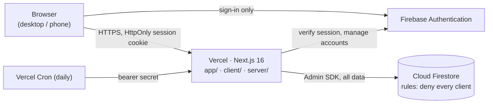

```
app/       routes: pages and thin API route files
client/    browser code: components, theme, Firebase client SDK (client/auth only)
server/    server-only code: Admin SDK, sessions, security, services
shared/    pure code used by both: schemas, dates, Markdown interchange
tests/     vitest
```

Every request that changes data passes **Origin check → session → rate limit → strict Zod schema → service (owner from the session) → Firestore**. Layer boundaries are enforced by ESLint. Details: [Architecture.md](docs/Architecture.md) · [Database.md](docs/Database.md).

## Getting started

**Requirements:** Node.js 24 (`.nvmrc`), Git, a Firebase project (Auth + Firestore) and a Vercel project. Turn on two-factor sign-in everywhere.

```bash
git clone git@github.com:<owner>/lumen-quill.git
cd lumen-quill
npm ci
git config core.hooksPath scripts/hooks   # pre-commit: gitleaks · pre-push: no direct pushes to main
npm test                                  # no external services needed
```

**Secrets never live in the project folder.** Keep them in a file outside it and pass it with `--env-file`:

```bash
node --env-file=../secrets/lumen-quill.env scripts/with-env.mjs dev
```

Variable names: [.env.example](.env.example) · full list and meaning: [Operations.md → Environment](docs/Operations.md#2-environment-variables).

Setting up from scratch: [Operations.md → Setup](docs/Operations.md#1-setting-up-from-scratch) (Firebase Auth and Firestore, indexes and rules, service account, Vercel, the administrator account).

## Commands

| Command | What it does |
|---|---|
| `node --env-file=<file> scripts/with-env.mjs dev` | Development server (`localhost:3000`) with secrets from a file |
| `npm run build` / `npm start` | Production build and server |
| `npm run lint` | ESLint, including layer boundaries |
| `npm run typecheck` | TypeScript |
| `npm test` | All tests (no external services) |
| `npm run audit:deps` | `npm audit`, any severity fails |
| `node --env-file=<file> scripts/bootstrap-admin.mjs` | Create or repair the single administrator |
| `node scripts/apply-rulesets.mjs <owner>/<repo>` | Apply the GitHub rulesets in `.github/rulesets/` |

## Documentation

| Document | Contents |
|---|---|
| [User-Guide.md](docs/User-Guide.md) | How to use the app, illustrated (writers and the administrator) |
| [Pages.md](docs/Pages.md) | Map of pages, tabs and menus |
| [Architecture.md](docs/Architecture.md) | Layers, request flow, caching, data model |
| [Database.md](docs/Database.md) | Firestore collections, indexes, rules, quotas |
| [Api.md](docs/Api.md) | Every endpoint |
| [Operations.md](docs/Operations.md) | Setup, environment, deploy, cron, quotas, backups, scripts |
| [Security.md](docs/Security.md) | Threat model, controls, provider settings, audit results, incident procedures |
| [Troubleshooting.md](docs/Troubleshooting.md) | Symptoms, causes, fixes |
| [Dependencies.md](docs/Dependencies.md) | Why each library is used, and pins |
| [Glossary.md](docs/Glossary.md) | Terms |
| [Agent.md](docs/Agent.md) | Context and rules for continuing the project with an AI assistant |

## Security

- Authorisation on the server for **every** request; the owner always comes from the session, and anything else answers 404.
- The browser never talks to Firestore: security rules deny every client, and all data goes through the server.
- HttpOnly `__Host-` session cookie, Origin + Fetch-Metadata CSRF checks, strict input schemas, byte limits, rate limits, a nonce-based Content Security Policy.
- Cost and quota guards: autosave throttling, cached reads, bounded retries, heavy-read limits, and a Firebase API key restricted to the app's domains and to the Auth APIs.
- No secrets in the repository (gitleaks in CI and pre-commit), no personal data in logs.

Details and the latest audit: [docs/Security.md](docs/Security.md). Found a vulnerability? See **[SECURITY.md](SECURITY.md)**.

## Conventions

- **Commits:** `feat:`, `fix:`, `docs:`, `chore:`, `test:`, `ci:` (English).
- **Branch → pull request → green CI → merge.** Merging to `main` deploys production; `main` is never pushed to directly. Releases are tagged `vX.Y.Z` with a GitHub Release and a `release/X.Y` branch.
- **Every change updates the affected documentation**, including [CHANGELOG.md](CHANGELOG.md). `tests/docs-consistency.test.ts` checks versions, links, images and the endpoint list.
- **Screenshots** in `docs/images/` use sample data only.

Contributing guide: [CONTRIBUTING.md](CONTRIBUTING.md).

## License

All rights reserved ([LICENSE](LICENSE)). The source is visible for reference; it is not open-source software.
