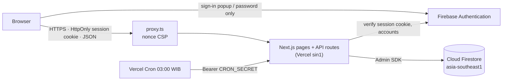

# Architecture

## 1. Overview



- The **browser** uses the Firebase client SDK only to obtain an ID token at sign-in. It exchanges it for an HttpOnly session cookie and signs the SDK out again.
- The **server** is the only holder of secrets and the only reader and writer of Firestore. Firestore security rules deny every client.

## 2. Code layout

```
app/                  routes
  (app)/              signed-in pages (layout: fixed top bar, session guard; template: page entrance)
  api/**/route.ts     thin route files → server/http/*
client/
  auth/               Firebase client SDK (only here), sign-in actions, session watcher
  components/         UI (home/, settings/, settings/admin/)
  lib/                api() with cache and de-duplication, importer, unsaved-changes guard, avatar resize
  theme/              globals.css (tokens for Sonata and Palace), ui.css (motion and components)
server/
  firebase.ts         the only Admin SDK import (one Firestore instance per process)
  auth.ts             session verification with a 60 s revocation check cache
  session.ts          requireUser / requireAdmin
  security/           CSRF, client IP, rate limiter (Firestore or in-memory per rule)
  http/               handlers: kit (safe, writer), auth, notes, account, data, admin, cron
  services/           notes, profile, admin, avatar, activity, app-settings, audit, retention
  page-guards.ts      session for server-rendered pages (never throws)
shared/               schemas (Zod), limits, days and time zones, text helpers, Markdown interchange
proxy.ts              per-request nonce Content Security Policy for pages
```

ESLint enforces the boundaries:
- `client/` and pages never import `server/`, except `server/page-guards`.
- Only `client/auth` imports the Firebase client SDK.
- Only `server/firebase.ts` imports the Admin SDK.

## 3. Request flow

Every mutation runs the same chain (`server/http/kit.ts → writer`):

1. **Origin** must equal `APP_ORIGIN`, and `Sec-Fetch-Site`, when present, must be `same-origin`.
2. **Session**: the cookie signature is checked on every request. Revocation and the Firebase *disabled* flag are re-checked at least every 60 s. The app profile must exist and not be disabled.
3. **Rate limit** per user (or per IP for sign-in).
4. **Body**: `application/json`, a byte limit checked before reading, and a strict Zod schema with no unknown keys.
5. **Service**: the owner always comes from the session. Another user's note answers 404.

Reads run steps 2 and 5. Admin endpoints also require the verified custom claim `role=admin` **and** the profile role.

## 4. Writing model

- A **note** document holds aggregates: title, created, updated, first/last day, entry count, words, preview.
- Each day is an **entry** document `notes/{id}/entries/{YYYY-MM-DD}`.
- "Today" is computed on the server from the user's time zone. Saving is allowed only for today; earlier days answer `403 day_locked`.
- Saving one day updates the entry and the note aggregates in one transaction. A `baseUpdatedAt` guard answers `409 conflict` when another tab wrote in between.
- The first save of a new day extends or restarts the writing **streak** on the profile, so Overview never scans entries.
- Clearing today's text deletes today's entry. Leaving a note with no entries deletes it (`DELETE …?ifEmpty=1`, re-checked in a transaction), and the daily cron removes any empty note older than 24 h.

## 5. Caching (quota)

| Layer | What | Lifetime | Invalidated by |
|---|---|---|---|
| Browser, `client/lib/api.ts` | GET answers | 60 s, tab memory | any POST / PUT / PATCH / DELETE; sign-out reloads the page |
| Next.js client router | rendered pages | 30 s (`experimental.staleTimes.dynamic`) | navigation after 30 s; Home click refreshes |
| Server instance | user profile | 15 s | any change to that profile on the same instance |
| Server instance | session revocation check | 60 s | sign out everywhere / disable on the same instance |

API responses stay `Cache-Control: no-store`, so nothing private is written to disk caches. Note links do not prefetch (each prefetch would be a server render).

## 6. Autosave

- **When it saves:** after a 2.5 s pause, at most once every 10 s while typing continuously, and on blur, on leaving, and on page hide (a keepalive request).
- **Failures:** a failed save retries after 5 s, 10 s, 20 s and so on, up to 2 min between tries. It stops after 8 attempts and the badge shows *Not saved*.
- **Rate limit:** autosave is limited in server memory, not in Firestore, so a save costs no extra database operations.

## 7. Live formatting

Today's box is a transparent `<textarea>` over a styled mirror. Both share the same font, padding, line height and wrapping. To keep every glyph the same width (so the caret never drifts):
- bold is a text stroke;
- italic slants **each word** with `transform: skewX(-12deg)` on an inline-block (same width, and lines still break between words). A font-based slant is not used: browsers may skip synthetic oblique for variable fonts, and a real italic face has different widths;
- markers keep their width and are only visually scaled and faded.

Read-only views (locked days) use the real italic faces (Inter Italic, Cormorant Garamond Italic).

Tests check that the mirror contains exactly the typed characters, including inside italic words.
