# User guide

How to use Lumen Quill, for writers and for the administrator. All screenshots use sample data.

## Contents

1. [Signing in](#1-signing-in)
2. [Home](#2-home)
3. [Writing a note](#3-writing-a-note)
4. [Settings](#4-settings)
5. [Export and import](#5-export-and-import)
6. [For the administrator](#6-for-the-administrator)
7. [Modes](#7-modes)

---

## 1. Signing in

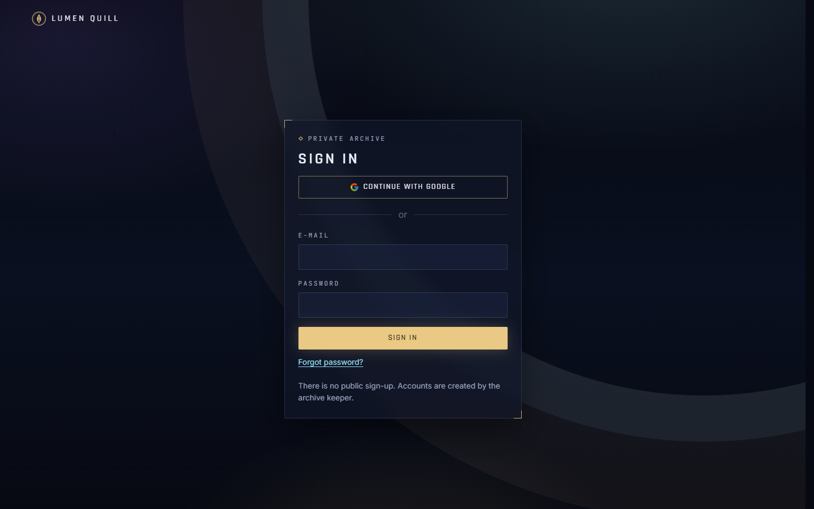

- **Continue with Google**, or your **e-mail and password**.
- There is no sign-up. Ask the administrator for an account.
- **Forgot password?** sends a reset link to your e-mail (the message never reveals whether an address has an account).
- Once signed in, opening the site goes straight to **Home**. Signed out, any app page sends you to sign-in.

## 2. Home

The top bar stays in place everywhere: the brand on the left (back to Home) and your profile photo on the right, which opens **Home**, **Settings** and **Sign out**.

At the top of Home:

| Button | What it does |
|---|---|
| **New note** | Always creates a new, separate note and opens it, ready for today |
| **Write today** | Continues the note you last wrote in. Same day: opens it straight away. A new day: asks (see below) |

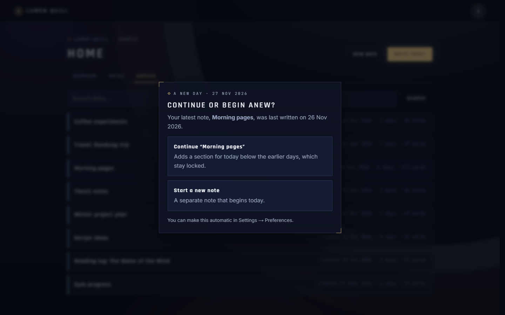

On a new day **Write today** offers:

- **Continue "title"**: adds a section dated today below the earlier days, which stay locked.
- **Start a new note**: a separate note beginning today.

You can make either choice automatic under **Settings → Preferences → A new day**.

### Overview

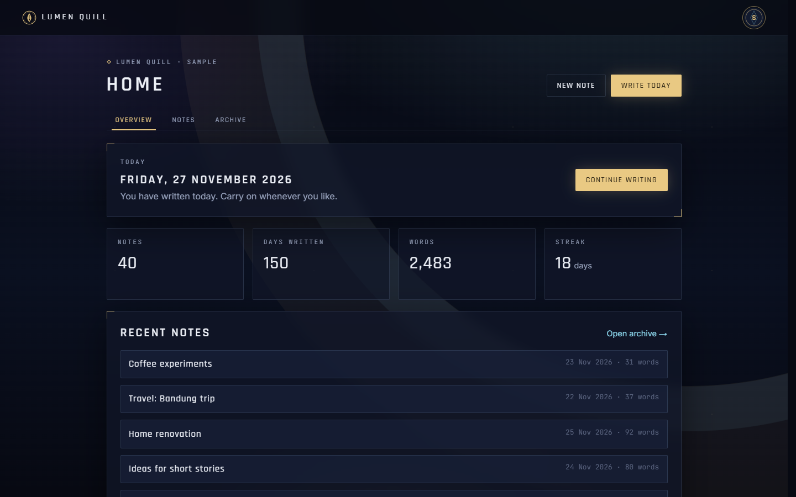

Today's date with **Write today** / **Continue writing**, your totals (notes, days written, words, current streak) and the five most recently created notes.

### Notes

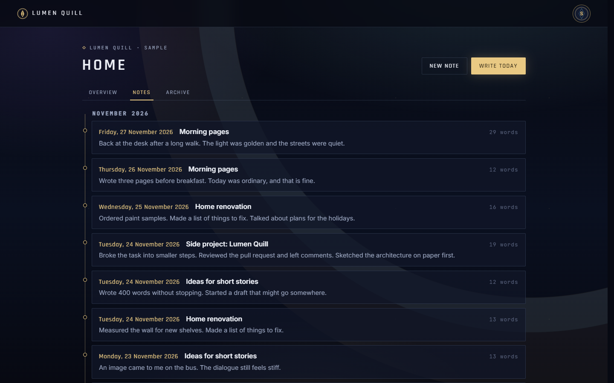

Every dated entry across all notes, newest first, grouped by month. Click one to open its note at that day.

### Archive

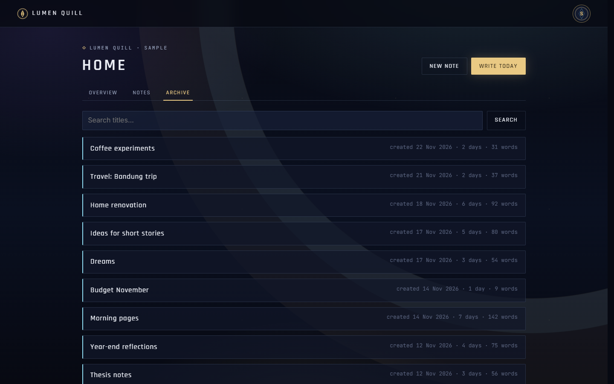

All notes in the order they were **created** (newest first; editing never reshuffles them), 20 per page. Type any page number to jump; a page past the end says which page is the last. **Search** looks through titles.

Which tab opens first is set under **Settings → Preferences → Open on**; clicking Home always brings you back there.

## 3. Writing a note

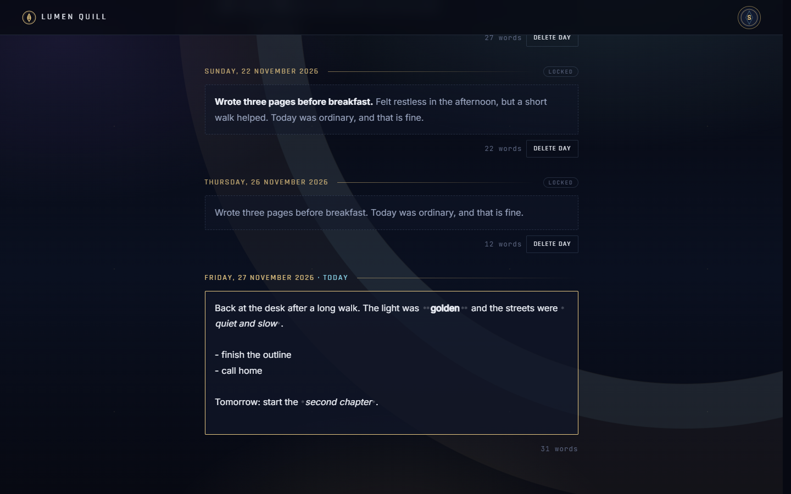

- A note is a stack of **dated sections**. Only **today's** section can be written; earlier days are **locked** (read-only, sized to their text). They can still be deleted with **Delete day**.
- Opening a note lands on today's section with the cursor after the last character. Continuing on the same day adds a new line for you.
- An older note opened from the Archive is read-only, with **Continue this note today** underneath.
- Typing saves automatically. The badge at the top shows **Saving…** and then **All changes saved**. If you close or reload the tab while a save is pending, the browser asks before leaving.
- `**bold**` and `*italic*` appear bold and slanted as you type. The asterisks stay but are small and faint; on locked days they are hidden and the text uses the real italic face.
- Clearing today's text removes today's section. A note with nothing written disappears when you leave it.
- **Export .md / .txt** downloads this note; **Delete** removes the whole note (after a confirmation).

To change an earlier day: export the note, edit the file, and import it as a new note.

## 4. Settings

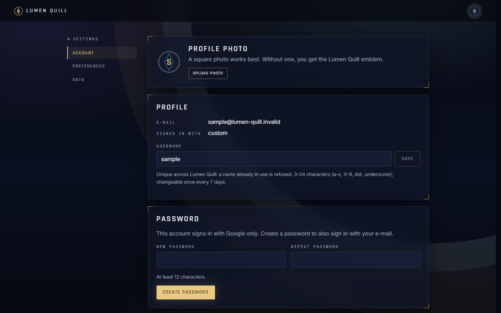

**Account**
- **Profile photo**: upload (JPEG, PNG or WebP, cropped to a square) or remove; without one you get the Lumen Quill emblem.
- **Username**: unique across Lumen Quill; changeable once every 7 days.
- **Password**: if you have one, **Send reset link** e-mails a one-time link (the password is never changed inside the app). A Google-only account can **create a password** here (sign in again first if it has been more than 10 minutes).
- **Sign out everywhere** ends every session on every device.

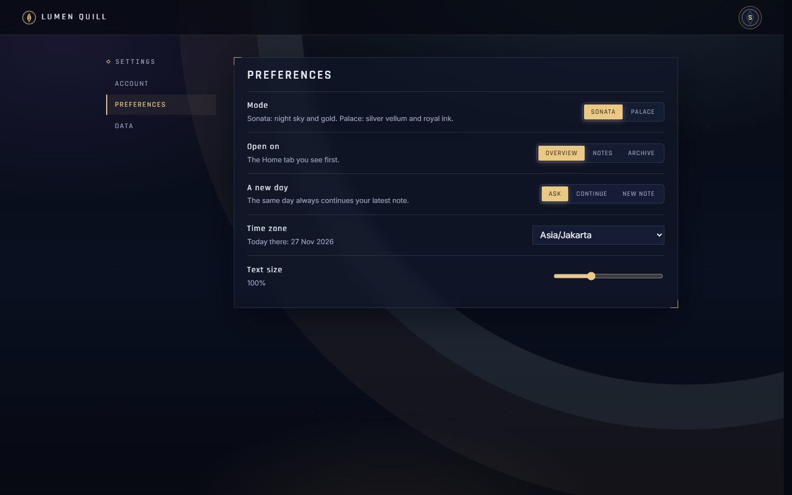

**Preferences**: mode (Sonata / Palace), the Home tab to open on, what happens on a new day (Ask / Continue / New note), time zone (decides which date a new entry gets) and text size. Changes save instantly.

## 5. Export and import

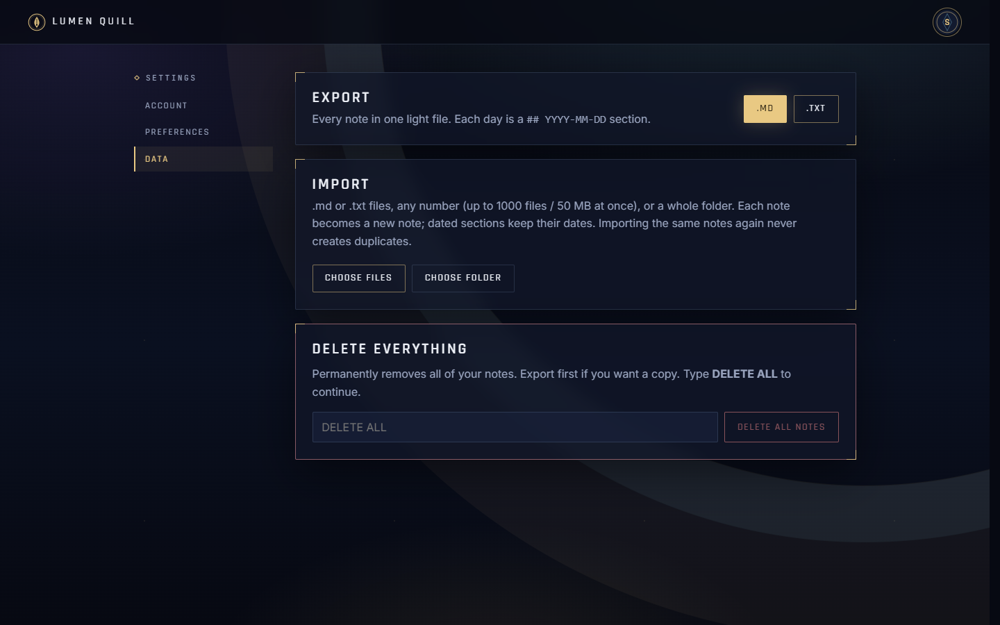

**Export** (Settings → Data, or a single note's page) produces plain text in either `.md` or `.txt`:

```
# Journal

## 2026-11-26

First day...

## 2026-11-27

Second day...

<!-- lumen:note -->

# Another note
...
```

- Exporting everything gives **one file** (`lumen-quill-export-YYYY-MM-DD.md`), notes ordered by creation date, newest first.
- A single note's file starts with the day it was created (`2026-11-14-morning-pages.md`).

**Import** takes `.md`, `.markdown` or `.txt` files:

- **Choose files** (any number) or **Choose folder** (including sub-folders), up to 1,000 files / 50 MB at once.
- A preview shows files · notes · days · size; **Import** sends them in chunks with a progress bar.
- Each note becomes a **new** note. A note whose exact content was imported before is skipped, so running the same import again never duplicates anything.
- Its "created" date is its first dated section. Text outside a `## YYYY-MM-DD` heading is dated today; a file without a `# Title` line is titled after its file name. Dates after today are refused.
- The free database allows about 20,000 writes a day (one per note plus one per day written). If that is reached, the import stops with a message: run it again the next day.

**Delete everything**: type `DELETE ALL`, then confirm once more in the dialog.

## 6. For the administrator

The administrator has an extra **Admin** section under Settings.


**Accounts**: every account with photo, sign-in methods, notes and last sign-in (scrolls after 5 rows, 10 per page). **Disable**, **Sign out** and **Delete** each ask for confirmation; Delete also needs the word `DELETE` and removes the account with all its notes. **Create account** with e-mail, a unique username and an optional initial password (leave it empty for a Google-only account).

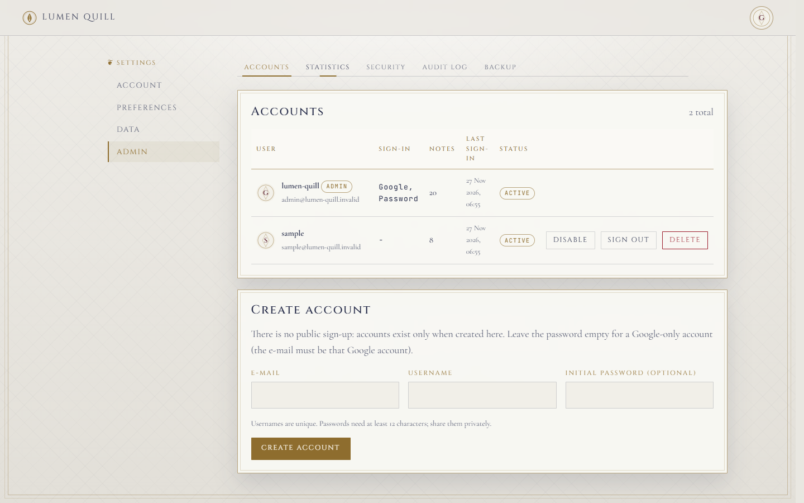

**Statistics**: totals and daily activity (saves, new entries, new notes, words). **Auto-delete statistics after** 1, 3, 7 or 30 days.

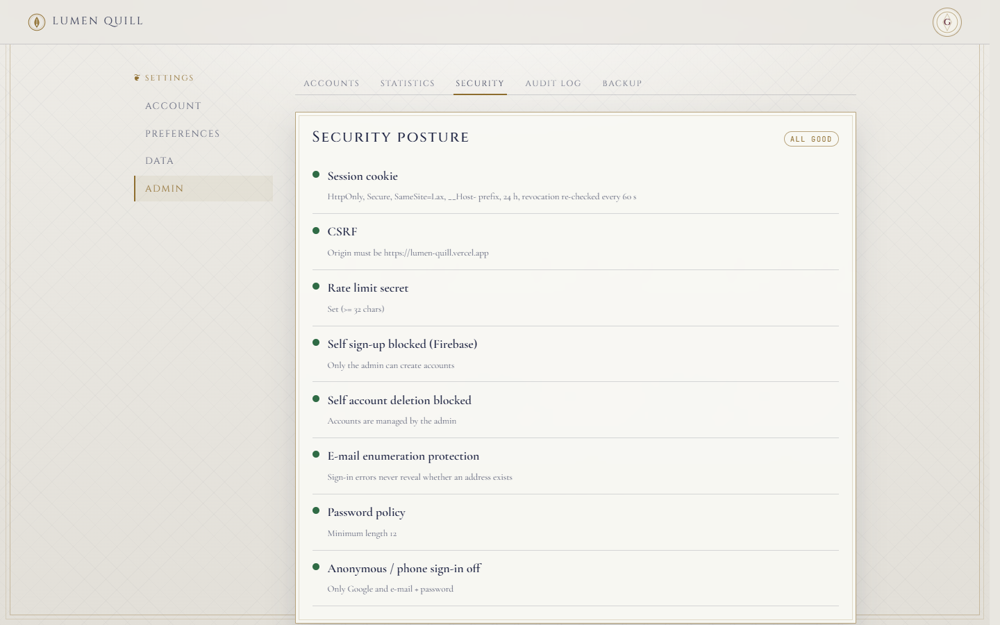

**Security**: live checks of the session settings and of the Firebase Auth configuration (self sign-up blocked, self deletion blocked, e-mail enumeration protection, password policy, anonymous / phone sign-in off), plus **Sign out all accounts** for emergencies.

**Audit log**: sign-ins (allowed and refused) and admin actions, with ids and codes only. **Auto-delete audit entries after** 1, 3, 7 or 30 days.

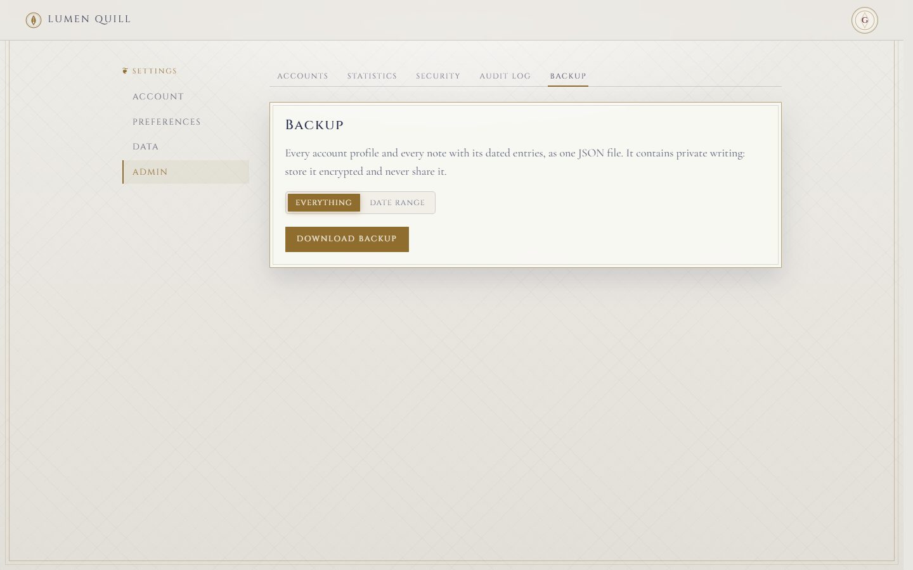

**Backup**: every profile and every note with its dated entries as one JSON file, either **Everything** or a **date range** (entries written on those days). It contains private writing: store it encrypted.

## 7. Modes

| Sonata | Palace |
|---|---|
| 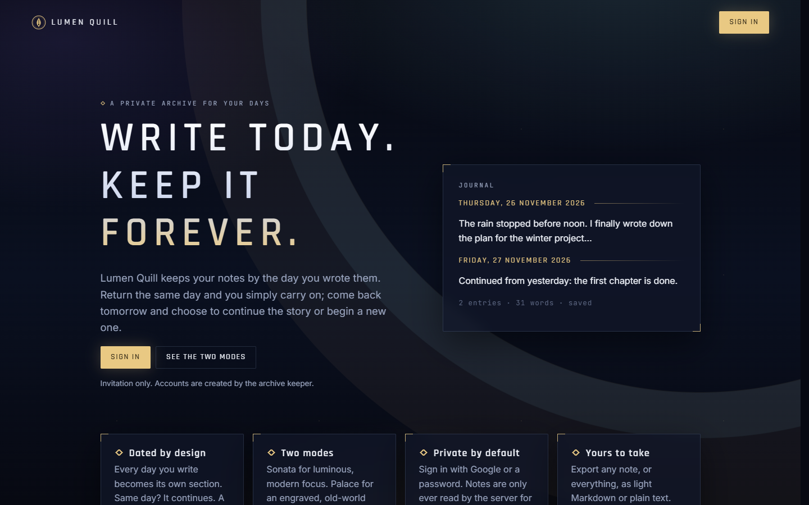 | 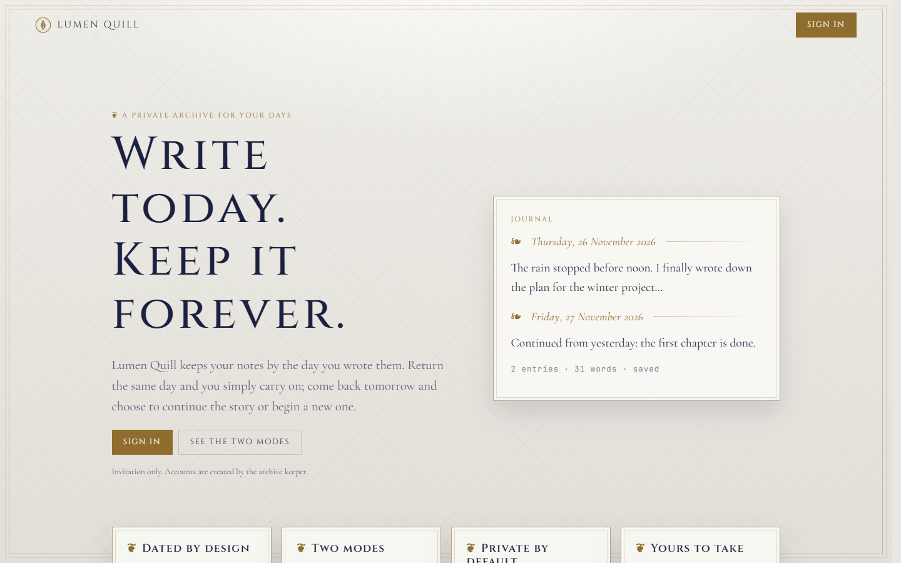 |
| Night sky, aurora haze, ivory type, gold filaments, bracketed panels | Silver vellum, royal ink, gilded double rules, engraved capitals, a ruled page |

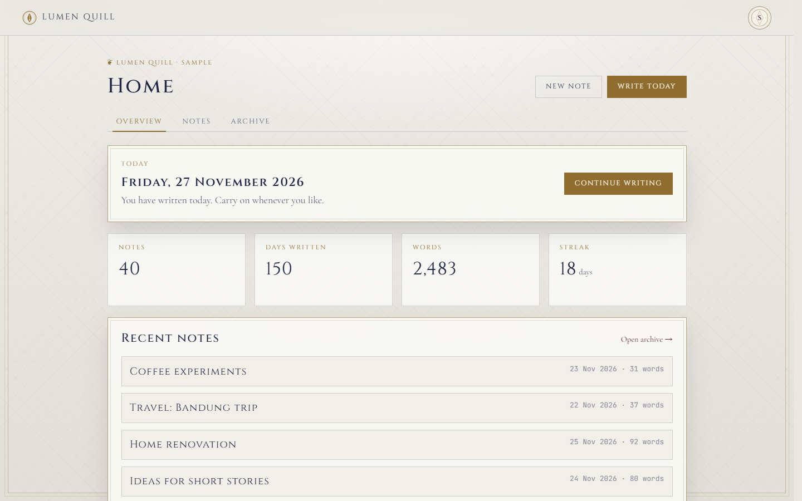

On a phone the same pages stack into one column:

<p align="center">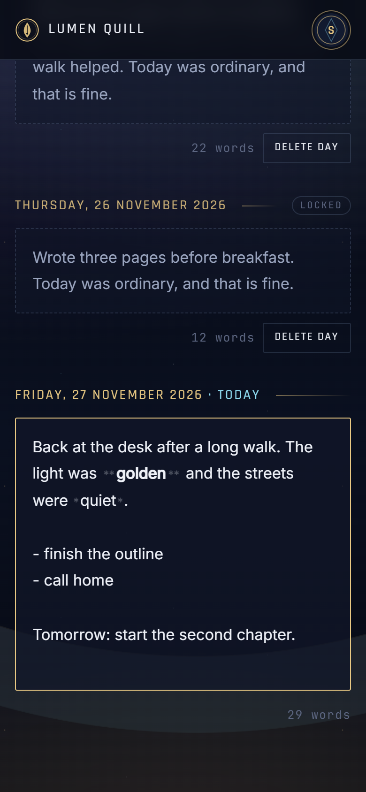</p>
